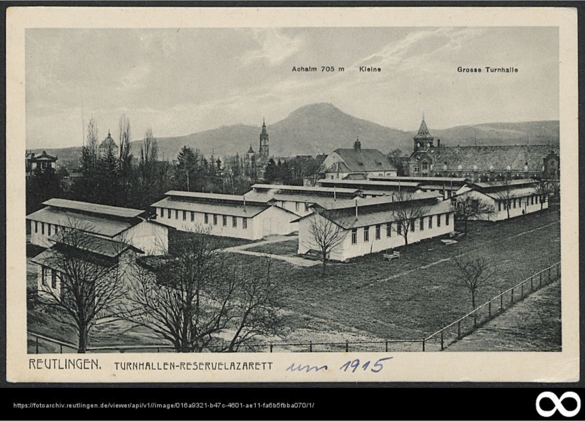

# Turnhallen-Reservelazarett

<quote>
Hier ist das Turnhallen-Reservelazarett auf der Rennwiese um 1915 zu sehen, in der Mitte die kleine und
große Turnhalle des Johannes-Kepler-Gymnasiums.
Quelle: Stadtarchiv Reutlingen, S 105/3 Nr. 3689
</quote>

