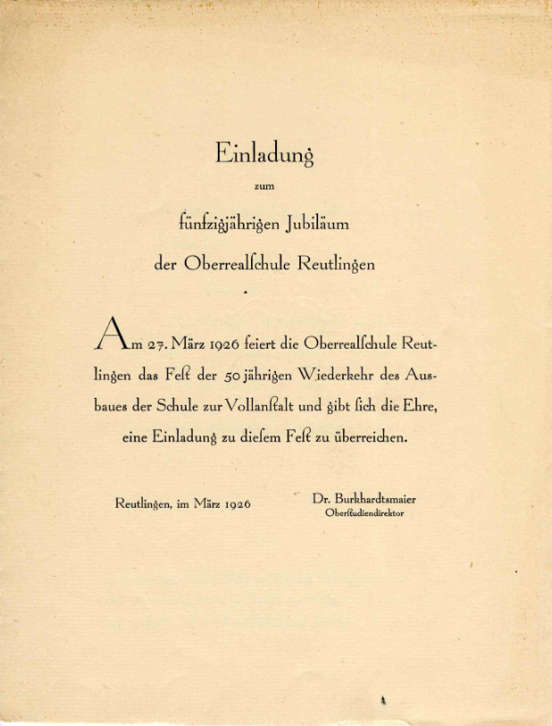
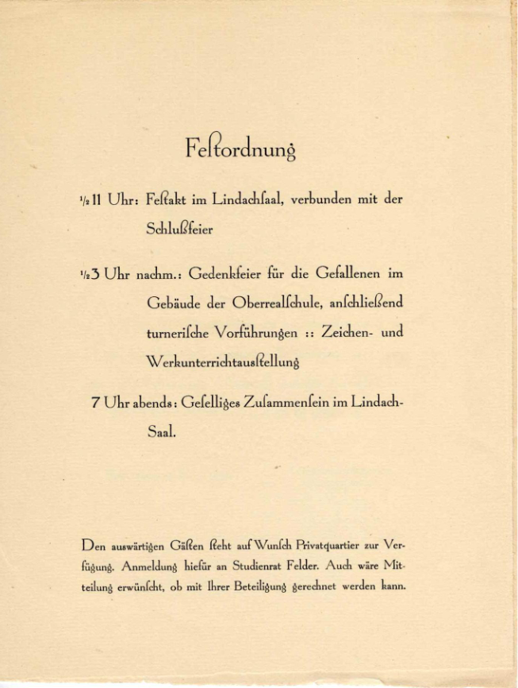
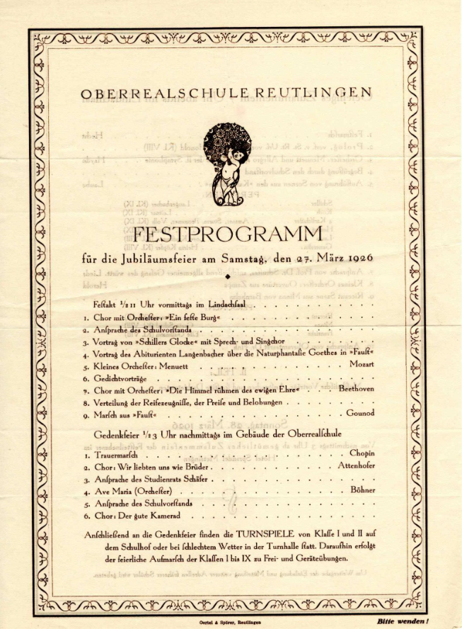
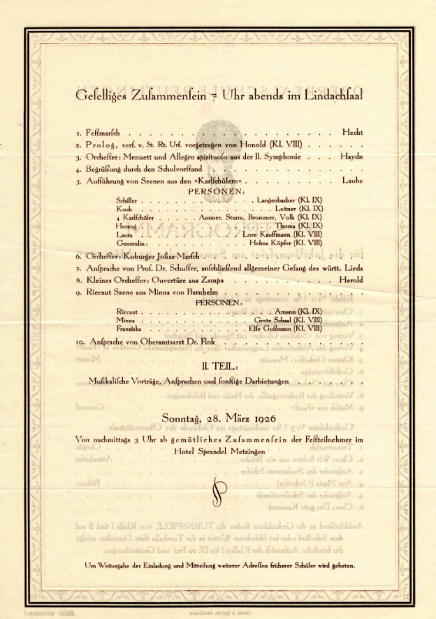

# Festprogramm

<quote>
Das Festprogramm vom 27. März 1926 mit Chor- und Orchesterauftritten, Theateraufführungen, Zeichen- und
Werkunterrichtsausstellungen und „Turnspielen“ zeugt von einem bunten kulturellen Leben an der Schule.
(private Leihgabe)
</quote>

